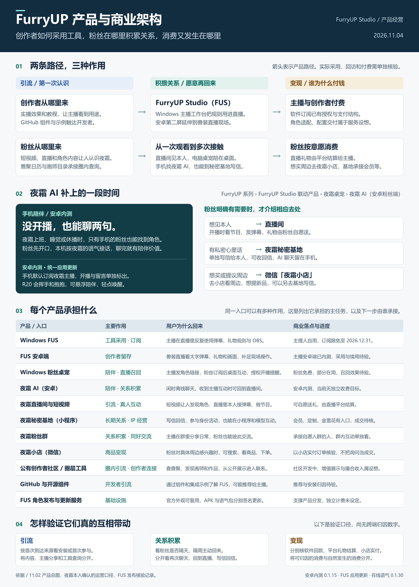
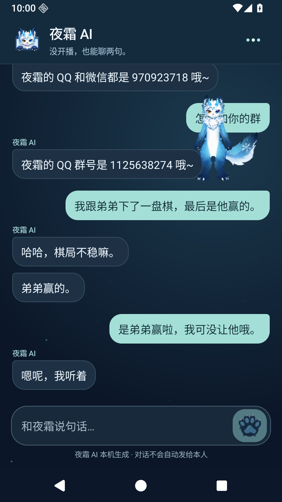
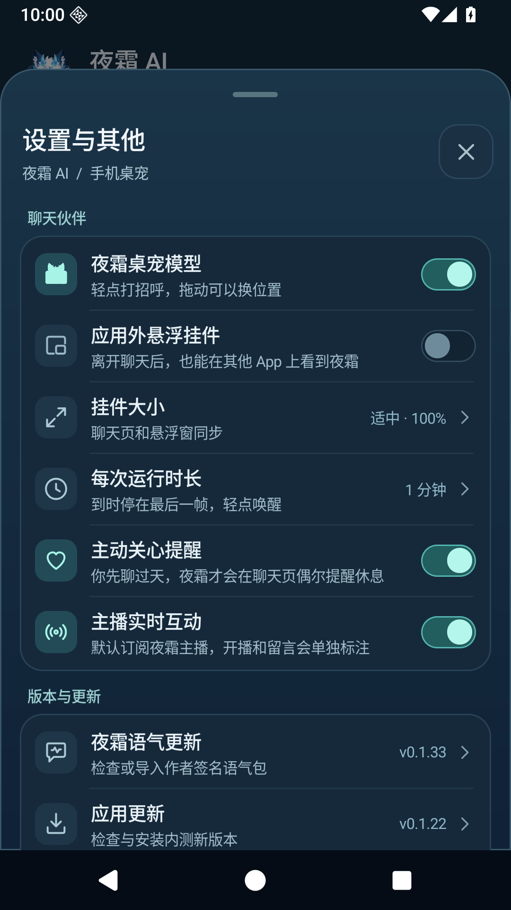
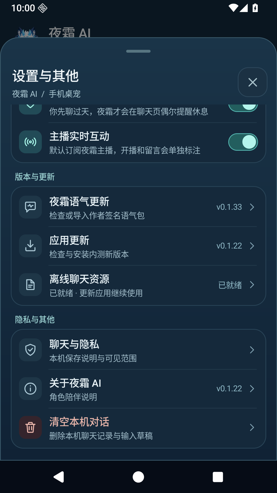
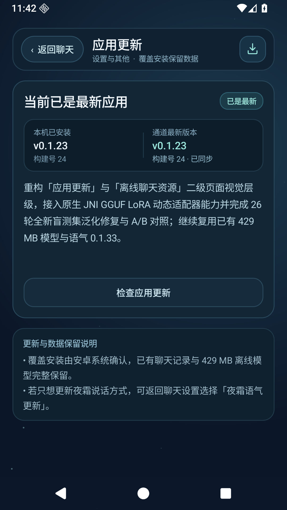
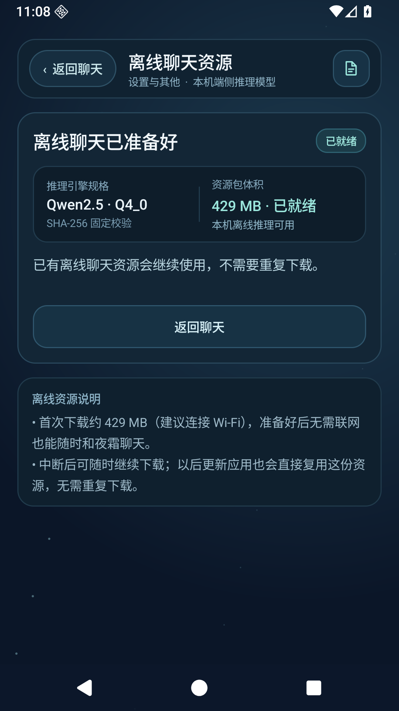
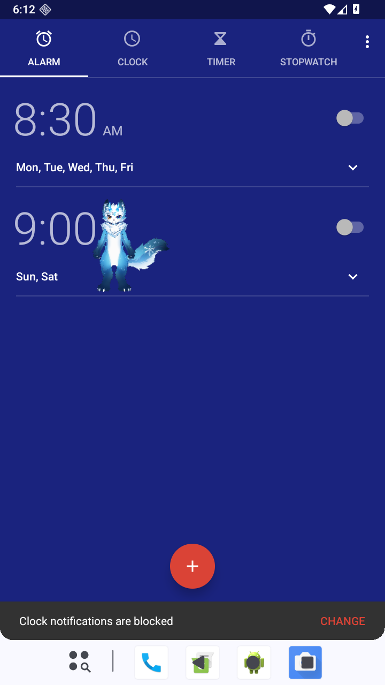

<p align="center">
  
</p>

<h1 align="center">夜霜 AI</h1>

<p align="center"><strong>没开播，也能聊两句。——把夜霜带到你的安卓手机与闲暇时光。</strong></p>
<p align="center">
  <a href="#下载客户端">下载安装包</a> ·
  <a href="#在-furryup-系列中的定位">FurryUP 产品定位</a> ·
  <a href="#产品展示与原生界面">界面与功能展示</a> ·
  <a href="#本次更新">0.1.23 更新</a> ·
  <a href="CHANGELOG.md">历史更新</a> ·
  <a href="NOTICE.md">闭源说明</a>
</p>

**夜霜 AI（Yeshuang AI）** 是 **FurryUP 系列** 下的安卓粉丝端角色陪伴应用（`FurryUP 系列 › FurryUP Studio 联动产品 › 夜霜桌宠 › 夜霜 AI`）。当夜霜上班、休息或未开播，而你身边只有手机时，无需联网上传聊天内容，即可在手机本地与夜霜 AI 日常闲聊；同时内置 **夜霜 R20 Live2D** 实时挂件，支持应用内互动与系统桌面悬浮陪伴，并默认订阅夜霜的 **FurryUP Studio（FUS）** 主播频道，在主播开播或发送实时互动时第一时间收到提醒。

---

## 下载客户端

当前安卓内测版本为 **0.1.23**（`versionCode 24`，Android 8.0 及以上，同时包含 `arm64-v8a` 真机与 `x86_64` 模拟器原生推理库）。已安装旧版的用户可直接覆盖安装或通过应用内更新升级，**已下载的 429 MB 离线模型与聊天记录自动保留复用**。

| 项目 | 当前版本 / 规格 | 下载入口 | 说明 |
| --- | --- | --- | --- |
| **安卓客户端（当前版）** | **0.1.23 内测版**（`code 24`，约 14.34 MB） | [GitHub 下载 APK](https://github.com/frostynight-furry/yeshuang-ai-releases/releases/download/v0.1.23/YeshuangAI-Android-0.1.23.apk) · [FUS 官方直链](https://frostynight.top/yeshuang-ai/android/0.1.23.apk) | 已安装旧版可直接覆盖升级，或在「设置与其他 → 应用更新」内一键升级 |
| **安卓客户端（上一版）** | **0.1.22 内测版**（`code 23`，约 14.30 MB） | [GitHub 下载 APK](https://github.com/frostynight-furry/yeshuang-ai-releases/releases/download/v0.1.22/YeshuangAI-Android-0.1.22.apk) · [FUS 回退直链](https://frostynight.top/yeshuang-ai/android/0.1.22.apk) | 遵循最新两版保留原则，供版本对照与回退核验 |
| **独立签名语气包** | **0.1.33**（Ed25519 签名，约 110 KB） | [随包内置 / Release 附件](https://github.com/frostynight-furry/yeshuang-ai-releases/releases/download/v0.1.23/yeshuang-voice-0.1.33.ysp) | 支持在不重装 APK 的情况下通过「更新夜霜语气」独立热更新 |
| **离线聊天资源** | **Qwen2.5 · Q4_0**（约 429 MB） | 首次开启自由闲聊时在「离线聊天资源」页按需下载 | 支持断点续传与 SHA-256 校验；后续升级 APK 无需重复下载 |

可在 PowerShell 中核对下载安装包的 SHA-256 摘要：

```powershell
Get-FileHash .\YeshuangAI-Android-0.1.23.apk -Algorithm SHA256
# 预期输出：799C8B5667055E28AB0F9FF478ACAE3334C6CE890FB4A2FD2D0B420CA8561E92
```

[0.1.23 发行说明](https://github.com/frostynight-furry/yeshuang-ai-releases/releases/tag/v0.1.23) · [0.1.23 SHA-256 校验文件](https://github.com/frostynight-furry/yeshuang-ai-releases/releases/download/v0.1.23/SHA256SUMS-0.1.23.txt) · [0.1.22 发行说明](https://github.com/frostynight-furry/yeshuang-ai-releases/releases/tag/v0.1.22)

---

## 在 FurryUP 系列中的定位

在 **FurryUP** 整体产品矩阵中，各条产品线围绕 **「创作者工具采用 → 跨端粉丝陪伴与关系积累 → 按意愿自然转化」** 分工协作。**夜霜 AI** 的核心定位是：

> **FurryUP 系列 › FurryUP Studio 联动产品 › 夜霜桌宠 › 夜霜 AI（安卓粉丝端）**
> —— **承接非直播时段的手机端离线角色伙伴与粉丝关系枢纽，同时也是 FurryUP 端侧 AI 与 Live2D 桌宠技术底座的官方第一方样板。**

| FurryUP 系列产品 | 面向人群与终端 | 核心职责与定位 | 关联仓库 / 入口 |
| --- | --- | --- | --- |
| **FurryUP Studio (FUS)** | 主播 / 创作者（Windows & Android） | 多平台弹幕礼物工作台、OBS 互动合成、兽装现场大字监看屏、向粉丝端发布角色与实时通知 | [furryup-studio-releases](https://github.com/frostynight-furry/furryup-studio-releases) |
| **FurryUP 桌宠** | 粉丝（Windows 10/11 & Win7） | 电脑桌面常驻陪伴；通过主播分享连接加载角色、接收表情与开播提醒 | [furryup-desktop-pet-releases](https://github.com/frostynight-furry/furryup-desktop-pet-releases) |
| **夜霜 AI（本产品）** | **粉丝（Android 手机）** | **休播与移动时段的随时陪伴**；本机离线大模型接话 + R20 悬浮桌宠 + 默认订阅夜霜主播互动提醒 | **本仓库 (`yeshuang-ai-releases`)** |
| **夜霜秘密基地** | 粉丝（微信小程序） | 长期 IP 关系经营：给夜霜本人私密写信与收信、全国兽聚日历、许愿池、守护榜与骑士团 | [yeshuang-secret-base-releases](https://github.com/frostynight-furry/yeshuang-secret-base-releases) |
| **夜霜小店** | 粉丝（微信小店） | 角色周边商品浏览与实付下单 | 微信搜索「夜霜小店」 |

### 为什么需要夜霜 AI？

1. **补上“没开播、也没在电脑前”的那段时间**
   主播不可能 24 小时在线，粉丝也并非时刻守在电脑桌前。夜霜 AI 把经过夜霜本人语料校准的对话体验与 **R20 Live2D** 模型装进安卓手机：粉丝先开口，手机本机按夜霜的语气自然接话，无需排麦、无需等待，聊完即有陪伴价值。
2. **严守“AI 伙伴”与“主播本人”的真实边界，克制按需分流**
   夜霜 AI 明确以「手机里的雪狐狸 AI 伙伴」身份陪伴，绝不冒充夜霜本人打字，也不虚假承诺代转话、代付款或查快递。仅当粉丝明确表达相应需求时，才自然指引对应去处：
   - **想见夜霜本人 / 看实时节目** → 引导前往 **直播间**（开播时看节目、发弹幕，通过 FUS 接收开播提醒）。
   - **有私密心里话想让夜霜本人看到** → 引导前往 **[夜霜秘密基地](https://github.com/frostynight-furry/yeshuang-secret-base-releases) 写信**（单独写给本人并可收回信，日常 AI 聊天则留在手机本地）。
   - **想买周边或提议新品** → 引导前往 **微信「夜霜小店」** 或基地写信提议。
3. **FurryUP 移动端基础设施的第一方标杆**
   验证了 **APK 与签名语气包（`.ysp`）分离热更新**、**429 MB 本地 GGUF 模型跨版本零流量复用**、**JNI 原生层 GGUF LoRA 适配器动态热挂载** 以及 **高刷屏幕固定物理步长插值 + 休息静帧省电** 等核心能力。

<p align="center">
  
</p>

---

## 产品展示与原生界面

以下截图均取自 **夜霜 AI 0.1.22 / 0.1.23** 安卓原生客户端实机渲染画面。

### 1. 离线聊天主界面与「设置与其他」分组面板

- **聊天主界面**：深海夜空主题搭配冰青色视觉焦点；采用非对称指向圆角气泡，清晰区分「夜霜 AI · 主动关心」与「夜霜 AI · 轻点互动」标签；右上角常驻 **夜霜 R20** 挂件，点按阅读气泡时角色自动半透明避让，不遮挡长句阅读。
- **设置与其他**：按「角色陪伴与互动」「版本与更新」「隐私与其他」分组卡片呈现；「显示夜霜挂件」「回复气泡提醒」「日常主动关心」「主播实时互动」4 项采用右侧胶囊开关，**点击直接在当前面板内切换状态，不会误关面板**。

<table>
  <tr>
    <td align="center" valign="top" width="33%">
      <p><strong>聊天主界面 · R20 陪伴</strong></p>
      
      <p>本地离线秒回，角色随对话做出表情反应。</p>
    </td>
    <td align="center" valign="top" width="33%">
      <p><strong>设置与其他 · 角色与互动开关</strong></p>
      
      <p>四项胶囊开关原地切换，首屏直达更新入口。</p>
    </td>
    <td align="center" valign="top" width="33%">
      <p><strong>设置与其他 · 版本与隐私</strong></p>
      
      <p>右侧胶囊徽章实时展示版本号与模型就绪状态。</p>
    </td>
  </tr>
</table>

### 2. 二级独立页面：应用更新与离线聊天资源（0.1.23 全新改版）

0.1.23 对「应用更新」与「离线聊天资源」两个独立页面进行了全面重设计，统一顶部 `‹ 返回聊天` 胶囊导航栏、状态总览大卡片、双栏版本/规格对照条以及主次/危险三级操作按钮层级。

<table>
  <tr>
    <td align="center" valign="top" width="50%">
      <p><strong>应用更新 · 双栏版本对照与签名核验</strong></p>
      
      <p>并排核对当前安装与更新通道版本，升级保留本地记录与模型。</p>
    </td>
    <td align="center" valign="top" width="50%">
      <p><strong>离线聊天资源 · 引擎规格与本地管理</strong></p>
      
      <p>约 429 MB 本地模型支持断点续传、完整性核验与跨版本复用。</p>
    </td>
  </tr>
</table>

### 3. 系统桌面悬浮陪伴与 R20 动作表情联动

- **系统桌面悬浮窗**：开启「运行方式 → 悬浮在系统桌面」并授予悬浮窗权限后，夜霜 R20 可跨应用陪伴在手机桌面上，支持 `50%–1000%` 尺寸无级缩放、自由拖动与一键复位。
- **高刷物理插值与休息静帧省电**：尾巴摆动按 R20 原设定的固定物理步长计算并根据屏幕刷新率平滑插值；到达设定的活动时长（1 / 2 / 5 分钟）后自动保留最后一帧进入零重绘省电休息状态，轻点角色即可立即唤醒。
- **对话情绪联动**：根据对话语境自动触发挥手、抱抱、害羞、单眼眨眼、吐舌以及张嘴红瞳蝠牙等专属动作。

<table>
  <tr>
    <td align="center" valign="top" width="50%">
      <p><strong>安卓系统桌面跨应用悬浮实测</strong></p>
      
      <p>跨应用悬浮陪伴，休息时保留最后一帧节省电量，轻点恢复实时渲染。</p>
    </td>
    <td align="center" valign="top" width="50%">
      <p><strong>R20 张嘴红瞳蝠牙表情特写</strong></p>
      
      <p>对话互动触发专属表情与动作，结束后自然恢复站姿。</p>
    </td>
  </tr>
</table>

---

## 本次更新

### 0.1.23 · 2026-11-06

- **二级页面 UI 统一重设计**：重构「应用更新」与「离线聊天资源」页面，新增统一顶部胶囊返回栏（`‹ 返回聊天` + 标题副标题 + 专属图标徽章）、动态状态胶囊、双栏版本与引擎规格对比条、主次/危险三级操作按钮与底部说明卡片。
- **26 轮未见过盲测集泛化修复**：新增 26 轮全新盲测对话集（`blind-dialogues.json`）并完成通用句式修复——修正同句内「原来放在A、改放进B」时误取旧位置的问题，新增成对物品分配（给他人A、自己留B）、同容器物品回忆、人物关系+事项双重纠正、跨轮双主体宠物归属、未知自造词不强行解释及口语化边界试探的识别与整形，**26/26 盲测集与 30/30 冻结集（合计 56 轮）全部满分通过**。
- **原生 JNI GGUF LoRA 动态挂载支持**：`libyeshuang_chat.so` 新增运行时 GGUF LoRA 适配器挂载、缩放与卸载恢复能力（切换时自动清空 KV 前缀缓存），完成 `0.5B Base` 与 `0.5B + Round2 LoRA` 端侧实测对照；默认生产配置继续复用零额外下载负担的 `0.5B` 模型与 `0.1.33` 语气包。

### 最近更新摘要

- **0.1.22 · 2026-11-06**：重绘右上角冰青三点图标；「设置与其他」改为分组圆角大卡片 + 原地胶囊开关（点击开关不关闭面板）+ 二级面板返回导航；聊天页采用非对称指向气泡、点按气泡半透明避让与空状态破冰话题胶囊。
- **0.1.21 · 2026-11-06**：深度优化多轮上下文记忆与人称/归属校准，消除无关示范导致的幻觉，强化身份与代发/代付能力边界，支持上滑翻看更早历史消息与桌宠一键复位，30 项冻结上下文评测 100% 通过。

完整演进记录请查看 [CHANGELOG.md](CHANGELOG.md)。

---

## 关于本仓库（闭源说明）

本仓库仅提供 **夜霜 AI** 官方安卓客户端安装包（APK）、签名语气包、产品定位介绍、实机界面截图与版本更新说明。

- **源码不开源**：客户端应用源码、原生推理与渲染引擎代码、夜霜 Live2D 模型源文件、专属语气角色卡及训练数据均属于私有闭源资产，不在本仓库或任何公开渠道提供。
- **关于 Source code 压缩包**：GitHub Release 页面自动生成的 `Source code (zip)` 与 `Source code (tar.gz)` 仅包含本仓库的公开说明文档与展示图片，不包含任何应用源码。安装安卓客户端请直接下载 Release 附件中的 `.apk` 文件。
- **隐私与本地数据**：日常聊天记录保存在你的安卓设备本地，离线模型在手机端直接完成推理；仅在检查更新或按需接收 FurryUP Studio 主播公开互动通知时访问官方服务。

发行主体为苏州工业园区夜霜文化创意工作室（个体工商户）。权利与闭源声明详见 [NOTICE.md](NOTICE.md)。
